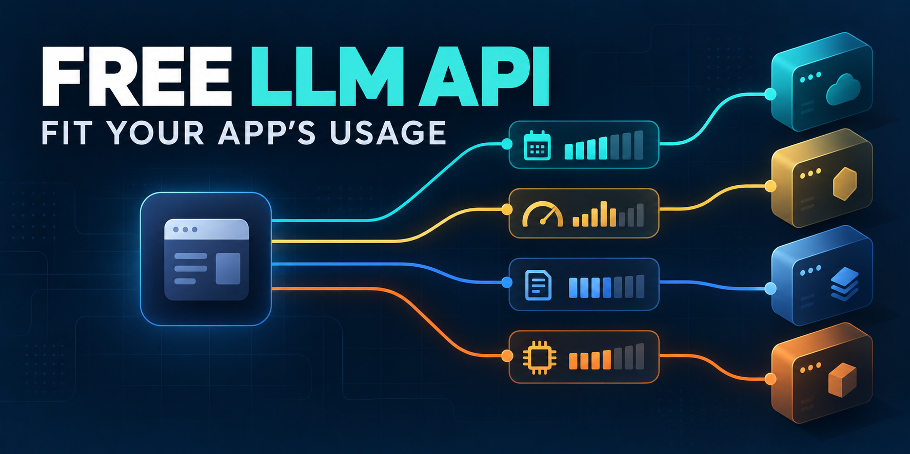
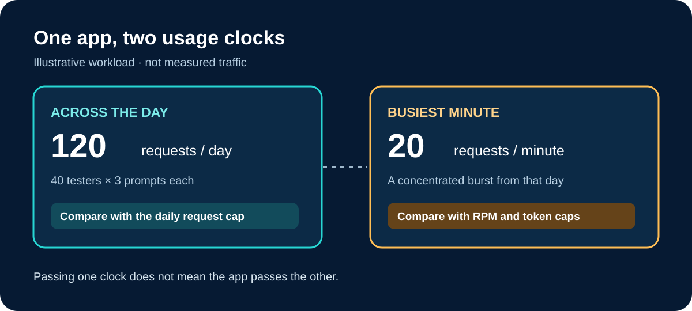

# Which Free LLM API Fits Your App’s Usage?

A free LLM API can cover a prototype’s daily volume and still reject calls during its busiest minute. Start with your expected requests **per day**, requests **per minute**, and input and output tokens—not a provider’s “free” badge. For a small text experiment, consider Gemini directly if your chosen model and project qualify. Groq’s Free tier is another candidate when its model and organization limits fit. OpenRouter Free is useful for trying several models at very low volume; Cloudflare Workers AI may suit an app already built on Workers. None is a universal production recommendation.

This comparison uses public vendor documentation checked October 28, 2026. It does not include account-level API calls, quality tests or latency measurements. A free chat website, trial credit, free model weights and a free hosted API are different offers; the rest of this guide compares documented hosted API routes for text features.

*Illustration: one app, four possible API routes, each with a different usage constraint.*

## Four routes, four different meanings of free

The useful comparison is the *limit that stops your app*, plus what you need to verify before choosing it.

| Route | Documented free mechanism | Usage unit to check | Fits when… | Reconsider when… |
|---|---|---|---|---|
| Gemini API, direct | Some model pricing rows show free-tier input and output; eligibility is project-specific. | Requests/minute, input tokens/minute and requests/day for the exact model and project. | You want one eligible Gemini model and its data terms fit. | Your project is ineligible, the model has no free tier, or a peak hits a project limit. |
| GroqCloud Free, direct | A Free tier exists; a paid Developer upgrade changes capacity and billing. | Organization-level requests and tokens per minute/day, including any separate input/output limits. | A supported model fits your workload inside your organization’s displayed limits. | Several apps share the organization quota or a burst reaches any limit. |
| OpenRouter Free, multi-model | Its Free plan lists free models and 50 requests/day. | Requests/day, plus model-specific availability and conditions. | You are exploring models with a small number of calls. | Your app needs more than 50 calls/day or specific provider controls. |
| Cloudflare Workers AI | 10,000 Neurons/day are included; some models require paid billing. | Neurons consumed by the specific model and request. | Your app already uses Workers and eligible model usage stays inside the allocation. | The model is paid-only or shared Neuron use exhausts the daily allocation. |

Read the live [Gemini API pricing](https://ai.google.dev/gemini-api/docs/pricing), [Groq rate limits](https://console.groq.com/docs/rate-limits), [OpenRouter pricing](https://openrouter.ai/pricing/) and [Workers AI pricing](https://developers.cloudflare.com/workers-ai/platform/pricing/) before implementation. These units cannot be converted into a fair “most free calls” ranking without a chosen model, prompt and account. A plan can pass the daily test and fail at the minute-level ceiling. Groq’s published limit table is a high-level summary, not a Free-plan entitlement; its page says to use your organization’s limits page for exact values, while its [billing FAQ](https://console.groq.com/docs/billing-faqs) distinguishes Free from paid Developer usage.
## Translate your app into quota demand

Write down a normal day and a busy minute before opening a provider dashboard. **Illustrative workload, not a measured app:** 40 testers send three prompts each, producing 120 requests/day. Suppose 20 arrive in the busiest minute. If each request uses about 800 input tokens and 300 output tokens, the day implies roughly 96,000 input and 36,000 output tokens; that busy minute implies roughly 16,000 input and 6,000 output tokens. Longer conversation history, retrieval context or retries increase those figures.

*For this hypothetical app, a daily cap and a peak-minute cap are separate gates.*

That workload already exceeds OpenRouter Free’s documented 50 requests/day, even though the prompt itself might be short. For Gemini, compare the 20-request burst and token totals with the **active limits shown for your project and model**; Google says exceeding any applicable dimension triggers a rate-limit error. For Groq, check the whole organization, because another app can consume the same quota. For Workers AI, this token arithmetic does **not** predict Neuron use: the model’s consumption and any other Workers AI usage must be checked in its own unit.

A free path that fits today can be wrong at launch. Estimate a peak multiplier and decide what the app should do on a 429 or other limit error: queue, retry later, show a fallback, or move to a paid plan. Treat that as an application design choice, not a promise that free capacity will be available at every moment.

## What each route gives up

**Direct model access** reduces the number of parties in the integration, but it ties your feature to that provider’s model catalog, data terms and quota. Gemini’s price table marks free-tier content as used to improve Google products; a team with stricter data requirements must read the current terms before sending real user content. Google also says [some projects are not eligible for the Gemini API free tier](https://ai.google.dev/gemini-api/docs/troubleshooting). Making another key in the same restricted project does not resolve that restriction.

**A multi-model gateway** can simplify exploration, but a model labeled free is still governed by account and model rules. OpenRouter’s Free plan documents 50 requests/day and does not include every control in its paid plans. That is a useful sandbox for a handful of evaluations; it is a poor default for an app expecting the illustrative 120 daily requests. Model variety is an option, not proof that a specific model is always available.

**A serverless platform allocation** fits a different architecture. Workers AI’s daily free amount is measured in Neurons, not requests or tokens, and its pricing page lists models that require paid billing. Choose it when that deployment path and eligible model fit; do not translate 10,000 Neurons into 10,000 prompts. Self-hosting open weights is another route if control matters more than hosted convenience, but “free weights” do not remove compute, operations or reliability costs. Those costs are outside this hosted-API comparison.

## Check the exact model and account before integration

Use this short gate for the model and account you would actually deploy:

1. **Confirm the offer.** Is inference through the API included on a recurring free tier, or is the “free” label a chat UI, trial credit or model download? Check the exact model row and region/account eligibility.
2. **Map every limit.** Compare daily requests, busiest-minute requests, input and output tokens, and any model-specific or shared compute unit. The lowest ceiling for *your workload* controls the decision.
3. **Check exhaustion behavior.** Will calls return a limit error, require a paid upgrade, or be billed after an allowance? Decide the app’s user-facing fallback before traffic arrives.
4. **Check data and feature conditions.** Read the current data-use terms and confirm the features your app needs, such as context size or structured output, on the specific model. Pricing alone does not prove capability.
5. **Set a paid exit rule.** Record what volume or requirement will trigger another evaluation. Recheck current price, quota and service terms then; do not assume a free tier scales with the app.

This gate is more useful than copying an API example here: an example request cannot establish your account’s eligibility, remaining quota or production fit.

## Choose for your current load, then revisit the choice

If you need one eligible Gemini model and your project’s live quota plus data terms fit, start with that direct path. If a Groq-supported model fits, compare your organization’s displayed limits against the busiest minute. For a few exploratory calls across models, OpenRouter Free’s 50-per-day plan is easier to justify than it is for an app with steady traffic. If you are already deploying on Workers, check whether the exact Workers AI model and Neuron allowance fit. The choice changes when traffic, prompt length, model requirements, data policy or vendor terms change.

Moduck publishes this comparison and is itself an AI API aggregator and unified API platform for developers. Its documentation describes model and API access, including a demo chat path, but the available evidence does not confirm a recurring free Moduck LLM allowance or access to a particular model for your account. It is therefore a separate evaluation route, not a recommended “free” winner here.

If a unified API is relevant after this comparison, check Moduck’s current model and API documentation before planning an integration. [Read the documentation](https://docs.moduck.ai/). Confirm the specific model, limits and account terms there. No provider in this article was tested with a live request, so keep the final integration decision tied to your own verified model, account and regional conditions.
